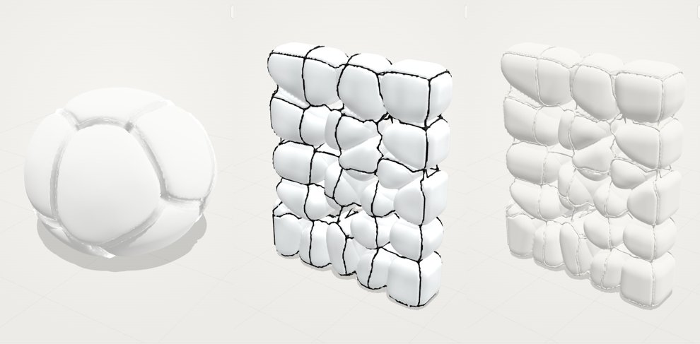

# FRAME/BLOB



A small browser-based 3D modelling environment for **inflated lattices**: a smooth, SubD-like strut frame built from 3D Voronoi / lattice subdivision, with metaball-style cushions that inflate *within* (or independently of) the frame and are pinched by it.

Print the frame, the blob, or both. Draw plans, sections and elevations. Log the process and keep the good versions in a library.


## Run it

No build step, no install. It's a static site with Three.js vendored in `vendor/three`.

```bash
python3 -m http.server 8000      # or: npx serve .
# open http://localhost:8000
```

To publish on **GitHub Pages**, go to Settings › Pages, pick "Deploy from branch", choose `main` and `/ (root)`, and it runs as-is.

## How the geometry works

| Stage | What happens | Key controls |
|---|---|---|
| **Boundary** | Convex constraint: box, ellipsoid, dome, cylinder (polyhedral approximations of curved ones) | size X/Y/Z |
| **Lattice** | Seeds: random, cubic, BCC (Kelvin truncated octahedra), hex prisms, staggered hex. Density gradient along an axis, Lloyd relaxation, cull, manual cell toggles | cells / divisions, jitter, relax, seed |
| **Voronoi** | Exact convex cells by half-space clipping of the boundary polytope | — |
| **Subdivision** | Second-order Voronoi *inside* each active cell gives a secondary strut order (thinner) | sub-cells / cell, sub strut ratio |
| **Frame topology** | **Surface seams** (default): only the cords where neighbouring cushions meet on the outside, relaxed into smooth curves. Or **all cell walls** (3D lattice), or **walls + outer cage** | topology, cord smoothing |
| **Frame** | Thin struts become exact **swept cords** (Catmull–Rom tubes), thicker ones a fused SDF. Tapered capsules + node spheres fused with polynomial smooth-min, giving filleted, SubD-looking joints. **Wrap** (on by default) projects cords onto a shrink-wrapped copy of the cushions so they pull taut over the crevices | frame mesh, radius, node bulge, taper, fillet, wrap, tautness |
| **Blob** | **Held by frame (default):** a membrane tied to the struts. Each exposed panel bulges outward by a dome profile that is 0 at its frame edges and full at the centre, so raising *Inflate* balloons the cushions between the cords without swallowing them. Shared walls stay flat; skin facets of curved boundaries are merged into one smooth panel (same crease rule as the frame). **Free:** each cell becomes a pillow: shrink by gap, inset and round by *roundness × inradius*, inflate, and "bulge past skin" on outer faces. Pillows union with smooth-min (**metaball merge**). Source can be the frame cells, the sub-cells, or a completely **independent** Voronoi field | inflate, roundness, gap, merge, pressure variance, bulge |
| **Pinch** | Blob minus (frame + clearance), smooth difference, so cushions crease where struts run | clearance, softness |
| **Mesh** | Signed-distance grid, then manifold Surface Nets as a **quad cage**. Then either Taubin smoothing (voxel mode) or **Catmull–Clark SubD** (0–3 levels), gradient normals | surface mode, resolution, SubD levels, smoothing |
| **Lattice FFD** | Trilinear free-form deformation over the whole result (frame + blob). Select control points, then move/rotate/scale them with falloff. Drawings, picking and the cut list follow the deformation | divisions W/D/H, falloff radius, strength |

Geometry runs in a Web Worker with stage caching, so changing an inflation slider doesn't recompute the Voronoi.

## Interface

- **Views:** Persp, Axon (true isometric ortho), Plan, Front, Side, Quad (4-up). Keys `1–5`, `Q`, `F` fit.
- **Display:** Frame / Blob / Cells (Voronoi wire) / Seeds / Ground, plus material presets (fabric + glass, frosted + cord, ETFE + steel, plaster, terracotta, dark diagram).
- **Lattice** (`L`): Atlas-style control lattice. Click, `Shift`-click to add, `Ctrl`-click to remove, drag a box (with `Ctrl` to deselect). The gizmo moves (`W`), rotates (`R`) or scales (`T`) the selection about its average. `A` selects all, `Esc` clears or exits. While editing, RMB orbits and MMB pans. Deformation survives division changes and model changes.
- **Shading:** a glass-rim frame shader (readable against white cushions), **Frame X-ray** (`X`) to see struts through the blobs, foil with iridescence, matte, ghost, **zebra** (reflection lines for judging SubD continuity), cavity, normals, back-face diagnostic, blob opacity, quad wire overlay with colour.
- **Lighting:** studio softbox environment with a key/fill/rim and accent rig, neutral room, dark studio; exposure (ACES); infinite fading grid.
- **Edit cells** (`E`): click a cushion or strut to toggle its cell, to carve openings and rooms.
- **Undo / redo** (`Ctrl+Z` / `Ctrl+Shift+Z`). Every committed change is logged.
- **Snapshot** (`S`): captures an iteration (thumbnail + parameters) into the Process tab. Click a thumbnail to restore it.
- **Variations** (`V`): generates 8 mutations (seed only / seed + form / lattice + form). Click one to adopt it, ★ to save it.
- **Library:** ★ Save (`Ctrl+S`) stores name, thumbnail, params and stats in browser storage. Search, tag, rename, export/import as JSON.
- **Drawings** (`D`): Plan / Front / Side with silhouette, section cut, contour slices and strut centrelines. Export **SVG** (true scale, named layers) or **DXF** (R12, layers).

### Credits: Minimal Surface Atlas 3

The lattice deformation, Catmull–Clark rules, studio lighting rig and softbox environment, foil and iridescence shader, fading grid and back-face diagnostic are ported from [whiteD1968/Minimal_Surface_Atlas_3](https://github.com/whiteD1968/Minimal_Surface_Atlas_3) and adapted to Z-up, mm-scale and the SDF pipeline.

## Exports

| Format | Contents |
|---|---|
| STL | frame only · blob only · combined (display meshes, binary, mm) |
| STL · print-ready | **watertight, closed 2-manifold.** The frame is fused into one solid on a fine grid fitted to the struts (draft ≈ r/1.9, fine ≈ r/3.2 voxels), cords spline-sampled and filleted at junctions. The blob is re-meshed with marching tetrahedra. The lattice deformation is applied |
| OBJ · SubD | **pure quads, closed manifold** for Rhino `ToSubD` / Blender Subdivision Surface: the control cage, or the cage after Catmull–Clark. Built with manifold surface nets (one vertex per surface patch) and a hair-thin offset where cushions pinch together |
| OBJ | frame and blob as separate objects |
| GLB | with PBR materials (Y-up converted) |
| SVG / DXF | plan, front, side; section, contours, centrelines |
| PNG | current view at 2× |
| CSV | cut list: struts (length, radius, level), nodes (xyz, valence), length bins |
| JSON | design parameters · library · process log |
| PNG | iteration sheet: grid of snapshots with captions |
| URL | share link with parameters encoded in the hash |

## Architectural product directions

See the **Ideas** tab in the app. Each one links to a preset.

1. **Pneumatic pavilion / canopy.** Steel or GFRP Voronoi frame with ETFE cushions, in the lineage of the Water Cube (Weaire–Phelan) and Eden Project, but irregular with smooth nodes.
2. **Acoustic wall relief / ceiling cloud.** Fabric or felt pillows on a cord or bent-rod frame. Inflation depth sets absorption depth.
3. **Furniture.** Pouf, lounge or bench: printed or cast resin exoskeleton with upholstered cushions.
4. **Blown-glass or cast lighting.** Balloons blown into a wire cage. The pinch becomes the mould line.
5. **Fabric-formed concrete or plaster.** The frame becomes formwork ribs (from plan contours) and the membrane inflates between them.
6. **Façade or screen modules.** Hex or staggered lattice in a thin box: repeatable cladding units with inflated translucent pillows.
7. **Playscape / soft architecture.** A dome at metre scale. Cull cells for entrances.
8. **Kit-of-parts.** Printed node connectors plus cut struts from the CSV cut list.

## Roadmap / proposed tools

- Node-connector export: each node as a printable socket with strut stubs and labels
- Cushion patterning: unroll pillows into flat sewing or ETFE cutting patterns
- Physical inflation: dynamic-relaxation membrane (pressure vs. frame tension)
- Attractor points and curves driving density, inflation and radius locally
- Import any closed mesh as the boundary
- Rhino / Grasshopper round-trip (`.3dm` via rhino3dm), IFC
- Quick FE structural check on the strut graph
- Turntable and process animation export
- Cloud library and team review links

## Project layout

```
index.html            app shell + import map
src/main.js           app wiring, panels, library, process, variations, drawings
src/viewer.js         Three.js viewport, cameras, materials, picking, capture
src/engine.js         cached geometry pipeline (worker or main-thread)
src/worker.js         Web Worker entry
src/params.js         parameter schema, defaults, presets, materials
src/geom/voronoi.js   boundaries, seeds/lattices, convex clipping, subdivision, strut graph
src/geom/field.js     SDF grids: frame, blob, pinch, wrap
src/geom/mesh.js      surface nets, Taubin smoothing, normals, volume
src/geom/drawing.js   marching squares, projections/sections, SVG + DXF writers
src/geom/ffd.js       lattice FFD: warp, Newton inverse, resample, falloff weights
src/lattice.js        lattice editor: points, selection, marquee, transform gizmo
src/shaders.js        studio env + rig, fading grid, foil/iridescence, rim, zebra, ghost, cavity, back-face
src/exporters.js      STL / OBJ / GLB / PNG / CSV
src/store.js          library, session log, snapshots, undo, iteration sheet
vendor/three          three.js r187 (MIT)
```

Units are model units (default mm). The status bar warns when struts are thinner than the voxel size; raise **Mesh › Resolution** before exporting.
